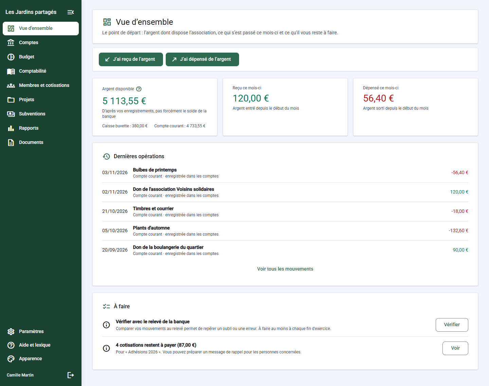
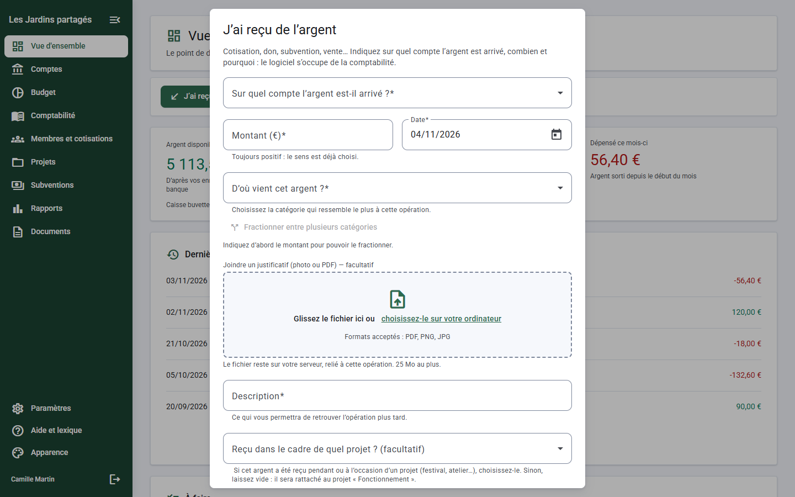
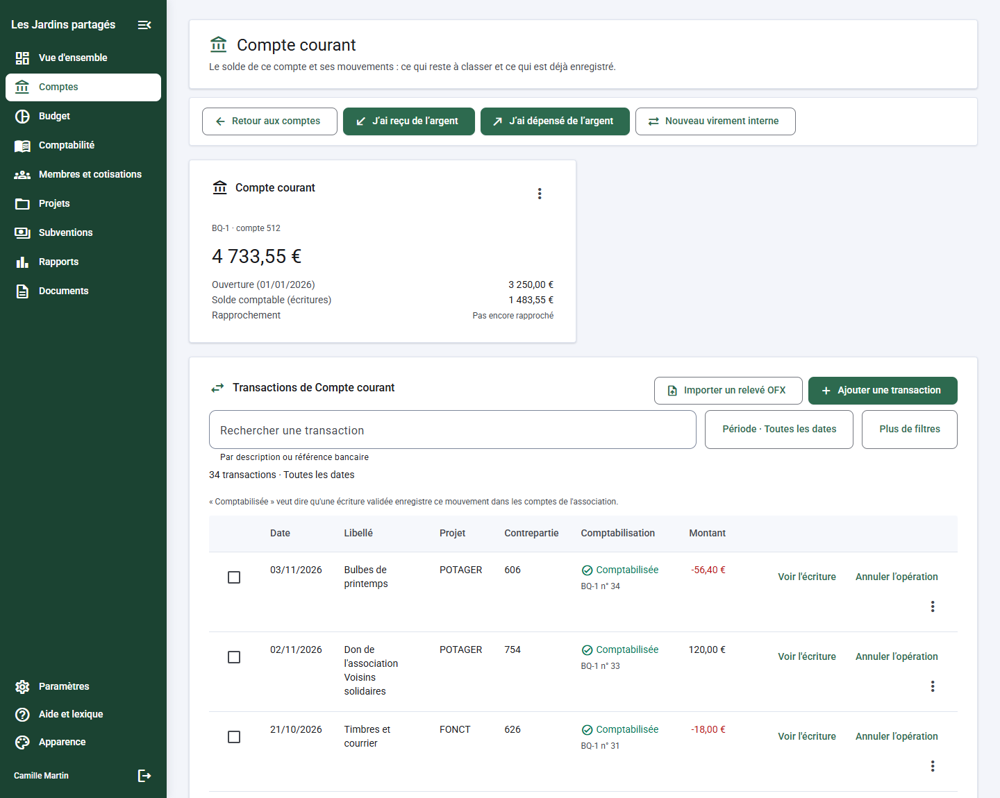
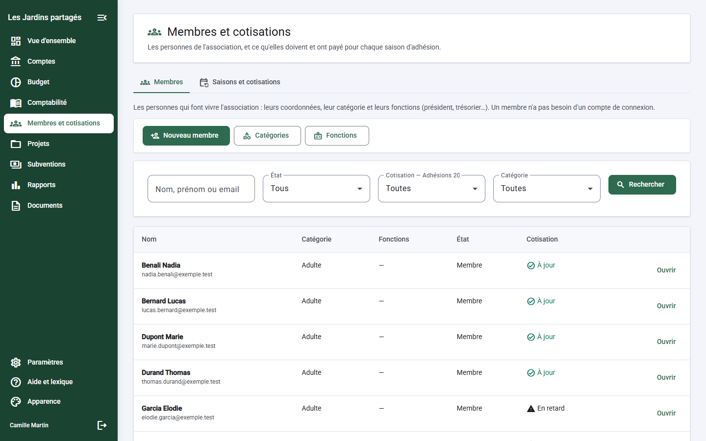
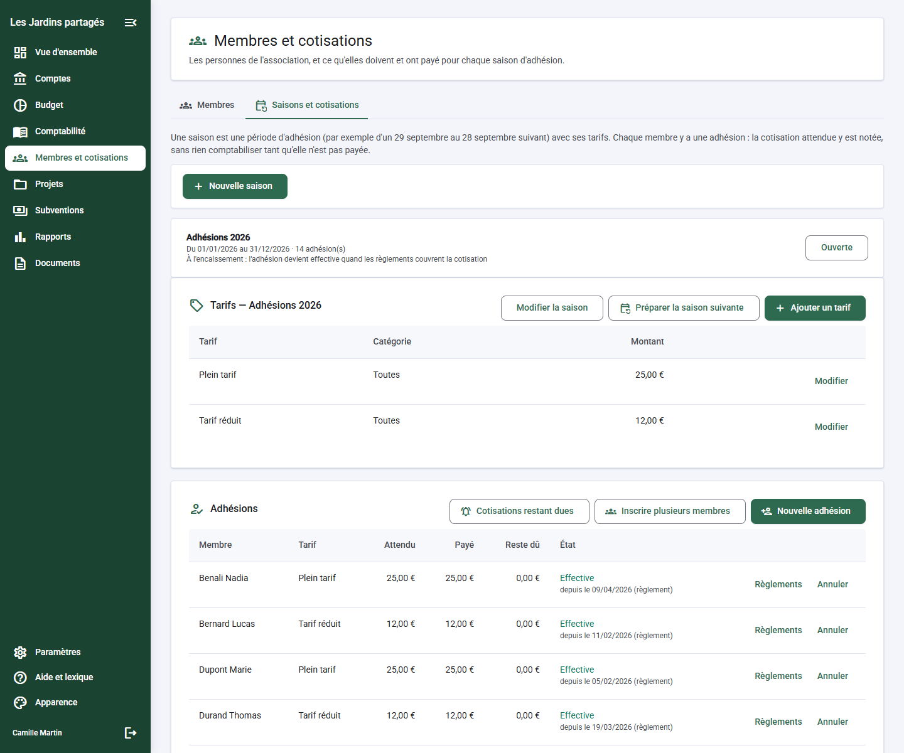
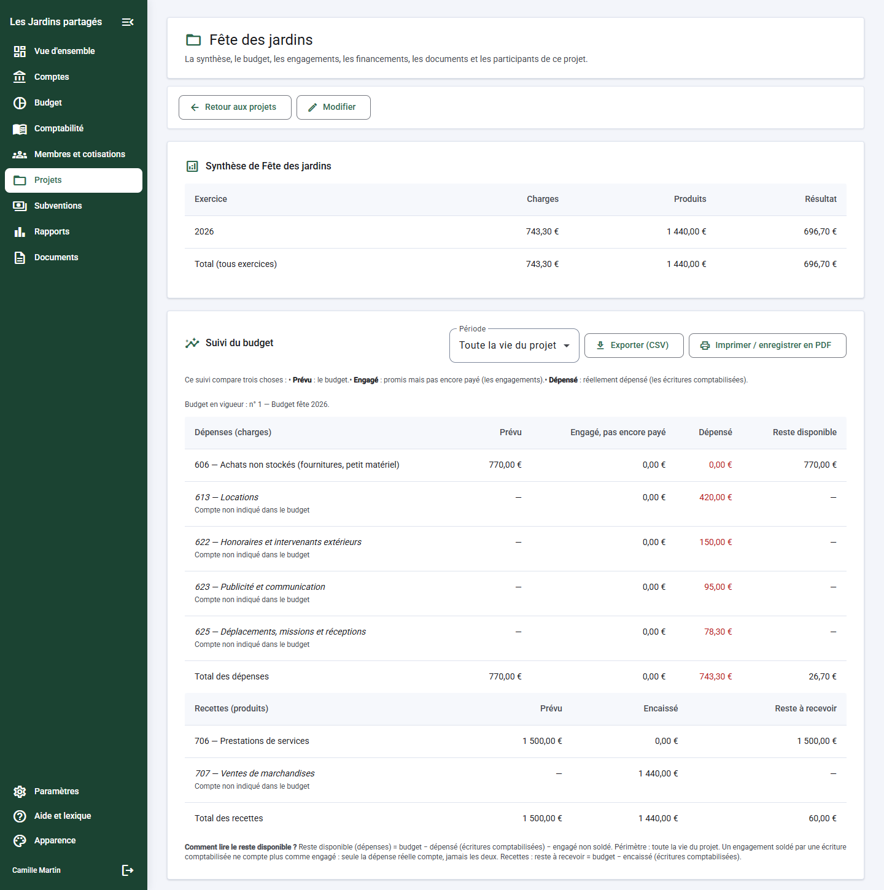
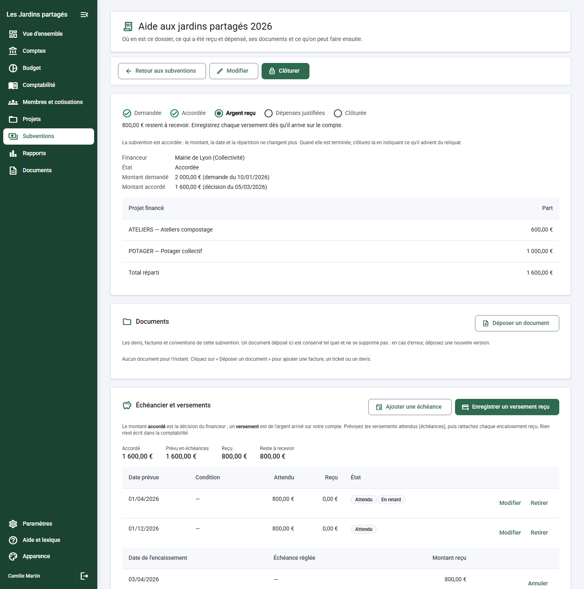
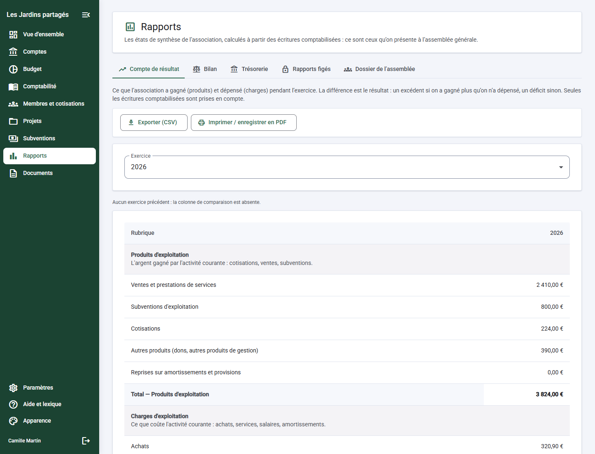
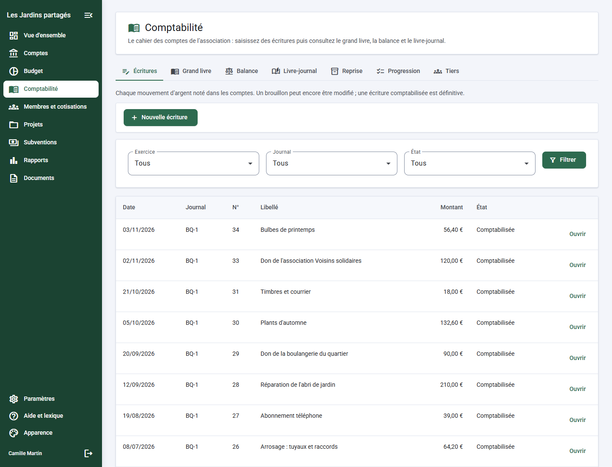

# Cotiasso

**Le logiciel libre qui aide les trésorier·ères d'association à tenir leurs comptes, sans avoir besoin de connaître la comptabilité.**

Cotiasso réunit la gestion de l'association (membres, cotisations, subventions, projets) et une comptabilité en partie double rigoureuse. La rigueur comptable est l'affaire du logiciel ; la personne qui l'utilise parle d'argent reçu et d'argent dépensé, et l'expert-comptable retrouve ses écritures, ses journaux et ses états de synthèse.

- **Une installation = une association.** Chaque association héberge sa propre instance, avec ses données chez elle.
- **En marque blanche** : nom, logo et couleurs de l'association.
- **Licence MIT**, application web, déploiement par Docker.

> **État du projet.** Cotiasso est en cours de développement. La conception fonctionnelle est rédigée mais pas encore validée par le trésorier de l'association pilote. Aucune conformité comptable ou fiscale (TVA, FEC, reçus fiscaux…) n'est affirmée à ce stade : le modèle de comptes proposé au démarrage est à faire relire par un expert-comptable. Voir la [feuille de route](docs/roadmap.md).

---

## Pour qui ?

Pour les trésorier·ères bénévoles, et les équipes qui les entourent : bureau, responsables de projet, expert-comptable. Chacun voit ce dont il a besoin et rien de plus.

L'application a deux affichages :

| | **Simple** (par défaut) | **Comptable** |
| --- | --- | --- |
| Pour | Le trésorier au quotidien | L'expert-comptable, ou le trésorier averti |
| Vocabulaire | « J'ai reçu de l'argent », « J'ai dépensé de l'argent », catégories en mots courants | Comptes, journaux, débit et crédit |
| Partie double | Montrée en lecture (« Ce que verra l'expert-comptable »), jamais exigée | Pleinement accessible |

Chaque page explique à quoi elle sert, chaque terme comptable est expliqué à côté du mot courant, et les erreurs disent ce qui s'est passé, pourquoi, et quoi faire.

---

## Aperçu

Les captures montrent l'affichage **Simple** sur une association fictive (« Les Jardins partagés ») : toutes les données sont inventées. **Cliquez sur une vignette pour l'agrandir.**

<table>
  <tr>
    <td width="50%" valign="top">
      <b>Vue d'ensemble</b><br>
      <a href="docs/images/vue-d-ensemble.png"></a><br>
      <sub>L'argent disponible, ce qui est entré et sorti ce mois-ci, les dernières opérations et ce qu'il reste à faire.</sub>
    </td>
    <td width="50%" valign="top">
      <b>Saisir en mots courants</b><br>
      <a href="docs/images/saisie-operation.png"></a><br>
      <sub>Une seule boîte pour « J'ai reçu » ou « J'ai dépensé de l'argent », avec catégorie, projet et justificatif. L'écriture comptable est générée par le logiciel.</sub>
    </td>
  </tr>
  <tr>
    <td width="50%" valign="top">
      <b>Comptes et mouvements</b><br>
      <a href="docs/images/comptes.png"></a><br>
      <sub>Le solde, la situation de chaque mouvement (à classer, enregistré, vérifié avec la banque) et l'import du relevé de la banque.</sub>
    </td>
    <td width="50%" valign="top">
      <b>Membres</b><br>
      <a href="docs/images/membres.png"></a><br>
      <sub>Le fichier des membres, leur catégorie et leur situation de cotisation : à jour ou en retard.</sub>
    </td>
  </tr>
  <tr>
    <td width="50%" valign="top">
      <b>Saisons et cotisations</b><br>
      <a href="docs/images/cotisations.png"></a><br>
      <sub>Les tarifs d'une saison, ce que chacun a payé, ce qu'il reste dû, les règlements et les rappels.</sub>
    </td>
    <td width="50%" valign="top">
      <b>Projets et budget</b><br>
      <a href="docs/images/projet-fete.png"></a><br>
      <sub>La synthèse d'un projet et son suivi du budget : prévu, engagé, dépensé, reste disponible.</sub>
    </td>
  </tr>
  <tr>
    <td width="50%" valign="top">
      <b>Subventions</b><br>
      <a href="docs/images/subvention.png"></a><br>
      <sub>Les étapes d'une subvention, son échéancier, les versements reçus et les dépenses affectées pour le compte rendu au financeur.</sub>
    </td>
    <td width="50%" valign="top">
      <b>Compte de résultat</b><br>
      <a href="docs/images/compte-de-resultat.png"></a><br>
      <sub>Ce que l'association a reçu et dépensé sur l'exercice, calculé à partir des opérations enregistrées (le bilan et la trésorerie suivent).</sub>
    </td>
  </tr>
  <tr>
    <td width="50%" valign="top">
      <b>Affichage comptable</b><br>
      <a href="docs/images/comptabilite-ecritures.png"></a><br>
      <sub>Pour l'expert-comptable : écritures numérotées, grand livre, balance et livre-journal.</sub>
    </td>
    <td width="50%"></td>
  </tr>
</table>

---

## Ce que l'on peut faire

### Démarrer sans se perdre

- **Un assistant de démarrage** guide l'association : période, catégories, compte bancaire.
- **Deux façons de démarrer** : reprendre l'historique de l'année en cours à partir des relevés bancaires, ou partir d'une **situation d'ouverture** (soldes de départ, ce qu'on vous doit, ce que vous devez).
- **Un modèle de départ** (comptes et catégories courantes d'une association) est proposé, modifiable, à ne pas écraser.
- **Un tableau de progression** montre où en est la reprise des comptes, compte bancaire par compte bancaire, et ce qu'il reste à faire.
- **Une vue d'ensemble** affiche l'argent disponible, ce qui est entré et sorti ce mois-ci, les dernières opérations et une liste « À faire ».

### Suivre l'argent au quotidien

- **J'ai reçu / j'ai dépensé de l'argent** : une seule boîte de saisie, avec une catégorie, un projet éventuel, un justificatif à glisser-déposer, et un aperçu de l'écriture comptable générée. Un montant peut être **fractionné** entre plusieurs catégories.
- **Comptes bancaires et caisses**, avec trois soldes bien distingués : de départ, calculé et comptable.
- **Import des relevés bancaires (OFX)** : rien n'est créé avant votre accord, les doublons sont repérés, les mouvements qui ressemblent à une saisie manuelle vous sont signalés, et le fichier d'origine est conservé. Réimporter le même fichier ne crée jamais de doublon.
- **Classer les mouvements** un par un, en masse, ou en acceptant des suggestions fondées sur vos habitudes. Rien n'est jamais classé sans votre geste.
- **Virements entre vos comptes** sans qu'ils soient comptés comme des recettes ou des dépenses.
- **Vérification avec la banque** (rapprochement bancaire) : on pointe les mouvements sur le relevé jusqu'à ce que l'écart soit nul.
- **Corriger sans effacer** : annuler une opération, changer sa catégorie, ou régulariser un montant se fait par écritures de correction reliées. L'historique reste lisible.

### Gérer les membres et les cotisations

- **Fichier des membres** avec catégories, statut, fonctions et mandats, et **anonymisation** possible d'un ancien membre.
- **Campagnes de cotisation** avec tarifs, dates et règle d'entrée en vigueur de l'adhésion (à l'encaissement, à la validation ou à une date fixe).
- **Nouvelle saison en un geste** : copie des réglages et des tarifs, puis **inscription en masse** des membres de l'an dernier.
- **Règlements** : paiement partiel, groupé pour une famille, trop-perçu, remboursement. On voit en un coup d'œil qui est à jour, en retard ou exonéré.
- **Rappels** des cotisations restant dues, exportables, et **reçu simple** imprimable pour un adhérent.

### Piloter les projets et les financements

- **Projets** avec ventilation de chaque dépense et de chaque recette, y compris répartie entre plusieurs projets, et un projet permanent « Fonctionnement ».
- **Budgets** par projet : on prépare, un membre du bureau approuve, chaque version reste consultable.
- **Engagements** : les dépenses promises comptent dans le suivi jusqu'à ce que la dépense réelle les remplace, sans jamais compter deux fois.
- **Suivi du budget** : prévu, engagé, réalisé, reste à dépenser.
- **Financeurs et subventions** : demandée, accordée, refusée, clôturée, avec échéancier des versements, dépenses affectées à la subvention, **compte rendu pour le financeur** et calcul du reliquat.
- **Participants** à un projet, à titre d'information.

### Produire les états et clôturer l'exercice

- **Compte de résultat**, **bilan** et **état de trésorerie**, comparés à l'exercice précédent, avec contrôle d'équilibre.
- **Grand livre, balance, livre-journal** et **soldes par personne** (adhérents, fournisseurs, financeurs).
- **Exports CSV sûrs** et impression en PDF depuis le navigateur.
- **Clôture d'exercice** en deux temps (fermeture à la saisie, puis clôture définitive), avec report automatique des soldes sur l'exercice suivant.
- **Rapports figés** : les états de l'exercice sont conservés avec une empreinte de contrôle, et leur **approbation par l'assemblée générale** peut être enregistrée avec le procès-verbal.

### Garder les pièces

- **Bibliothèque de documents** : factures, procès-verbaux, justificatifs. Un document peut être relié à un mouvement, un projet, une subvention ou un membre. Remplacer un fichier crée une nouvelle version ; un document ne se supprime pas, il s'archive.
- **Documents restreints** réservés aux personnes autorisées.
- Contrôle strict des formats acceptés.

---

## Sécurité, droits et traçabilité

- **Comptes et connexion** : invitation et réinitialisation par lien (par email si l'association a un serveur de messagerie, sinon le lien est remis par l'administrateur), protection contre les tentatives répétées.
- **Double authentification** (application d'authentification) obligatoire selon le rôle, avec codes de secours.
- **Rôles modifiables** et droits fins : tout est refusé par défaut. On peut limiter une personne à certains projets, par exemple un responsable de projet qui ne voit que ses budgets, subventions et documents.
- **Journal d'audit** que l'on ne peut pas modifier, chaîné par empreintes, avec vérification d'intégrité et export.
- **Écritures comptables inaltérables** : une écriture validée ne se modifie plus, elle se contrepasse. La numérotation est continue et sans trou, garantie par la base de données.
- **Données brutes conservées** : les relevés importés ne sont jamais réécrits.

---

## Pour les administrateurs

- **Marque blanche** : nom, logo, couleurs et accent de l'association, avec contraste de lecture contrôlé. Thème clair ou sombre, affichage confortable ou compact, utilisable sur mobile.
- **Paramètres versionnés** : on peut retrouver ce qui était en vigueur à une date donnée.
- **Sauvegardes chiffrées** de la base et des documents, **vérifiées** par restauration de test, avec **copie automatique hors site** facultative.
- **Mise à jour guidée** qui sauvegarde et vérifie avant de changer de version, avec notes de version affichées dans l'application.
- **Fonctions optionnelles** (TVA, immobilisations, fonds dédiés…) prévues sous forme de modules activables, uniquement une fois implémentées et validées. Une option non prise en charge est affichée comme indisponible, jamais acceptée à moitié.

---

## Pour aller plus loin

| Document | Contenu |
| --- | --- |
| [Feuille de route](docs/roadmap.md) | Ce qui est fait et ce qui reste, par priorité |
| [Notes de version](CHANGELOG.md) | Les nouveautés, version après version |
| [Cadrage fonctionnel](cadrage-gestion-associative.md) | Le périmètre et les règles métier |
| [Exploitation](docs/exploitation.md) | Installation, sauvegardes, restauration, mise à jour |
| [Décisions d'architecture et de règles métier](docs/decisions/) | Le pourquoi de chaque choix structurant |
| [Guide de conception de l'interface](design.md) | Les principes pédagogiques et les modèles d'écran |
| [CLAUDE.md](CLAUDE.md) | Conventions techniques pour qui contribue au code |

### Essayer en local

Prérequis : Node.js (version épinglée dans `mise.toml`) et Docker.

```bash
npm install
cp .env.example .env
npm run db:up
npm run db:generate
npm run db:migrate
npm run dev
```

L'application est alors servie sur http://localhost:4200. Au premier lancement, l'assistant d'installation demande un jeton à usage unique, affiché dans les logs de l'API. Pour un déploiement en production, voir [docs/exploitation.md](docs/exploitation.md).

---

## Licence

MIT.
